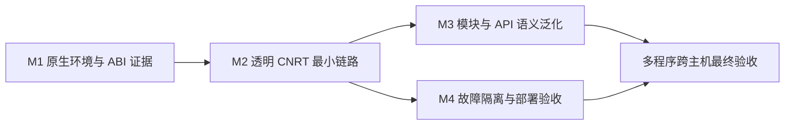

# M1～M4 实施路线与验收

基线：2026-11-02，Neuware 3.5.2 / CNCC 4.5.1 / AArch64 / MLU370-S4。
每一阶段的完成只对声明的范围成立；测试缺失不能用 API 导出数量代替。

## M1：架构审计和原生执行链路

当前状态：**当前工具链范围已完成**。已盘点原有 TCP/Session/对象表/六算子，参考 Cricket 和实际 CoreX 仓库；确认硬件、SDK、动态依赖、host stub、registration wrapper、CNFB/LZ4/device ELF 参数布局。原始证据和限制分别见 [审计](../docs/ARCHITECTURE_AUDIT.md) 与 [执行链路](../docs/BANG_EXECUTION_CHAIN.md)。

验收标准：

1. 原生 CNCC 程序在真实 MLU 上做数值检查；设备、版本、头文件哈希可追溯。
2. 保留可重建的 host/device 编译产物和汇编片段；解压 image 与 device object 逐字节一致。
3. 对参数大小、三维 task grid、错误状态使用原生探针；未知项有明确边界。
4. CNRT/CNDrv 公共声明全部进入台账，公开 API、私有 hooks 和服务端使用分别统计。

证据：`environment.log`、`image-audit.json`、`host-stub.txt`、`native_bang_*-native.log`、`api-semantics-native.log`、`compat/summary.json`。double 编译崩溃单独保留，不算执行支持。

依赖：可用的 CNCC/SDK/MLU。扩展到另一 Neuware 或 CPU 架构必须重新通过 M1；当前私有 ABI 不作为跨版本承诺。

## M2：透明 CNRT Shim 和通用 image launch

当前状态：**最小链路已实现，完整部署验收部分完成**。同一个普通 CNCC executable 已原生、同 SONAME replacement、LD_PRELOAD 运行；真实用户 image 上传/加载/launch，保留六 preset。隐藏 SDK 与 `/dev` 的客户端已通过；第二台物理主机尚未验收。

验收标准：

1. 业务源码不插入 remote API，同一 executable 的 SHA-256 保持一致，分别 native/replacement/preload 数值通过。
2. 用不存在于 preset registry 的 kernel，以及与 preset 同名但计算不同的 kernel，证明执行上传 image。
3. primitive scalar、allocation offset/NULL、xyz task grid、queue/notifier、reset/reload 有 native 和 remote 对照；不可靠 ABI 明确拒绝。
4. Client 运行不加载 vendor CNRT/CNDrv，不打开 MLU 节点；纯传输库在无 SDK 路径下能构建。
5. 在另一台真实 MLU 服务器启动服务端，从独立无 Driver 客户端执行相同 binary，记录两端 hostname、CPU/SDK、网络地址、哈希、命令和输出。

已通过前四项。证据：`native_bang_*-replacement.log`、`native_bang_*-preload.log`、`isolated-client.log`、`client.strace`、`driver-access.json`、`client-core-build.log`、`generic-protocol.log`。本轮用户选择本机模拟验收，已额外完成 [双终端隔离演示](../evidence/driverless-local-20261102/README.md)，不等待第二主机。第五项保留为后续独立部署验收，不能以 loopback 结果代替。

实现范围：ELF64 LE/CNFB v2 单 image；AArch64→AArch64；Block kernel；单设备/进程 session。后续 M3.1 已扩展到同一 registration/module 的多 kernel 和已测未初始化 globals 内部共享。Union 类型只转发，尚无完整验收。

## M3：模块、异步和 API 语义泛化

当前状态：**API 自动化及多个功能族工作包已落地，完整 M3 未完成**。依赖 M1 的 ABI 证据和 M2 的通用链路；以下按语义依赖推进，不按 API 数量凑进度。

2026-11-02 API 扩展批次新增 30 个公共 API（15 完整、15 部分），修复 5 个原拒绝入口（3 完整、2 部分）。Census 仍为 310 项，目前完整 36、部分 58、明确拒绝 4、未实现 212。已建立 device/version/properties、owned memory fill/stride copy、queue/notifier options/wait/timing、kernel attribute 的复用模式；[15 项新增检查 + 59 项完整回归](../evidence/api-expansion-20261102/README.md) 通过。实现与取舍见 [API 自动化](../docs/API_AUTOMATION.md)。

| 工作包 | 实施内容与依赖 | 原生与远程验收标准 |
|---|---|---|
| M3.1 模块注册 | 分离 ImageID/ModuleID/多个 KernelID；DSO load/unload 引用计数；依赖当前 upload | 同一 module 两个 kernel 共享 globals，native/remote 结果一致；多次 dlopen/dlclose、卸载时有 pending launch、reset 后注册重载；stale ID 拒绝 |
| M3.2 参数类型 | 获取可靠 compiler metadata 或构建期 sidecar；不要从标量值猜指针 | aggregate 含 pointer、extern C、模板、enum、零参数、pointer-to-pointer 各有原生布局及 remote 数值用例；没有可靠类型信息则保持拒绝 |
| M3.3 异步主机内存 | pinned host ownership、D2H 延后写回、queue completion；依赖稳定 completion 生命周期 | HostMalloc/FreeHost、异步 D2H 在等待前后主机可见性、交错 copy/launch、跨 queue notifier 等价；host buffer 提前释放的约束明确 |
| M3.4 设备/队列语义 | TLS device、native 默认 queue 隐式排序、priority/flags；依赖多设备硬件 | 双线程双设备交错、显式/默认 queue、跨设备对象拒绝、Union 能力族；仅有一设备时不算通过 |
| M3.5 CNDrv Shim | 原生 typed CNDrv client ABI；复用 session/module/memory RPC | 独立原生 Driver API 程序 native/replacement/preload 对照；不依赖客户端 vendor CNRT；此 SDK 的 TLS current binding、地址宽度、context flags 和错误等价有探针，不引入不存在的 push/pop API |
| M3.6 生成与台账扩展 | 以参数方向、长度、句柄类型、错误映射 schema 生成包装/编解码/分派；关键生命周期继续手写 | 生成物 `--check`，新增 API 每族有 native/remote/负例；台账、实际 exports、schema 对齐；缺 API 不伪装成功 |

M3.1 已完成一个 registration→一个 ModuleID→多个 KernelID、重复 lookup 身份稳定、parent/child 归属及级联失效，并通过两个 kernel 共享未初始化 device globals、独立加载相同 image 的状态隔离、reset 后重载、20 次 DSO 重载/保留 loader 引用/pending-work unload 的 native/remote 对照。隐藏 SDK 与设备的客户端也通过。见 [38 项验证及共享模块证据](../evidence/shared-module-20261102/README.md)。并发 dlclose、跨 DSO image 引用、Host symbol API、initialized/constant/external globals 仍未验收，**M3.1 只部分完成**。

M3.2 新增 CNCC `mlisa_kernel` IR→宿主 ELF 类型 metadata，按 image 指纹/精确 symbol/设备参数大小交叉核对；同一 module 的 C、enum、template、zero-arg kernel 数值通过，scalar 与 fake VA 相同也不误重定位。无 metadata 的旧程序保留保守 demangler。aggregate、pointer graph、Host symbol 和设备 i64→s48 语义边界仍需原生证据，M3.2 部分完成。

M3.6 已完成本轮自动化门槛：310 声明的 Schema 签名/功能族/参数/状态；原 10 对对象 RPC，加 20 typed RPC 的编解码/dispatch/binding、21 公共 wrapper、导出 map、台账/功能族计划和测试模板；contract checker 核对 SDK/Schema/Protocol/Export/Ledger/evidence，全部生成 RPC 的坏请求与坏成功回复实测通过。该生成范围已验收，buffer/复杂 lifecycle 的通用生成仍需继续扩展。H2D staging、非阻塞 transfer release、1200 次 launch/copy 保留原回归。

M3.5 已建立独立 Driver Shim：每个 native context 对应一条 remote session，TLS current binding、四种原生调度标志、立即文件/fatbinary module load、多个 KernelID、primitive/offset/NULL/xyz launch、显式/native NULL queue 与 notifier、带 native cleanup ACK 的销毁已实现。普通 Driver binary 的 native/replacement/preload 及无 SDK/设备视图验证见 [起步批次证据](../evidence/driver-shim-20261102/README.md)。本轮扩展后 56 个已导出公共入口中，17 已实现、38 部分实现、1 明确拒绝；台账分别检查两个 Shim 的导出。NULL queue async copy、真异步 D2H、完整 context API/默认队列隐式顺序、复杂 ABI 和多设备仍待验收，**M3.5 仍部分完成**。

double 参数验证依赖可工作的原生编译器或已验证的替代编译配置；当前 CNCC 崩溃需先向原生链路定位。multi-arch fatbin/SDK 升级需先更新 parser 选择策略及 M1 证据。

## M4：故障隔离、资源边界和真实部署

当前状态：**部分加固已完成，生产验收未完成**。依赖 M2；可与 M3 并行推进，但最终验收需要两者满足目标程序所用语义。

已完成：跨 session 对象拒绝、stale allocation/queue/kernel、reset、EOF cleanup 路径、通用协议负例、有界 parser 的 ASan/UBSan 变异检查；Client 严格检查成功回复形状，断线/坏回复使连接失效，后续请求不发送、不自动重放。

M4.1 新增：connect/RPC 和 server handshake/frame 收发绝对 deadline、合法首包后才创建 native context、重复 HELLO 拒绝；真实 TCP 故障、原生后端 backpressure/另一客户端持续工作、SIGSTOP/SIGKILL/restart 均有测试。重启探针暴露的确定性 ID 重复已改为随机启动 nonce 与全进程 sequence。配置及限制见 [连接生命周期](../docs/TRANSPORT_LIFECYCLE.md) 和 [证据](../evidence/transport-20261102/README.md)。DNS/native 取消、应用恢复尚未完成，M4.1 仍部分完成。

M4.2/M4.3 新增：session/进程设备请求字节、H2D staging、上传 image、未回收 transfer 和连接数配额；原子预留/失败回滚；SIGINT/SIGTERM 停止 accept、唤醒收发、等待全部 worker 完成 native cleanup；native 失败逐项报告，context 销毁失败时 quarantine 并停止准入。D2H 在 queue wait 成功后才同步读回，避免失败后的异步写入悬空回复缓冲。已通过并发额度争抢、拒绝前数值不变、6 次关闭/fd 复用、明确 NOT_READY 的有限 kernel/H2D drain 和清理失败注入。完整回归 [48/48](../evidence/resources-20261102/final-suite/results.json)，其中 [19 组资源检查及两个 backend 模式](../evidence/resources-20261102/README.md) 有真机与原生对照。实现边界见 [资源生命周期](../docs/RESOURCE_LIFECYCLE.md)。两工作包基础已验收，完整资源隔离和 native 有界取消仍未完成。

各工作包及剩余验收：

| 工作包 | 实施内容 | 验收标准 |
|---|---|---|
| M4.1 连接与取消 | connect/read/write deadline、强制首包 HELLO、故障状态可观察、显式恢复策略 | 半包/黑洞/服务端 kill/重启/网络中断及时返回；在途操作状态不明时不自动重放；旧句柄不能进入新 session |
| M4.2 总量隔离 | 基础配额/回滚已测；继续租户份额、公平性、native 内部资源计量及独立进程隔离 | 已验证耗尽、并发竞争、失败恢复和所列序列的 cnmon 回收；仍需持续负载、逐类资源计量、多设备/进程分池与公平性验收 |
| M4.3 关闭路径 | socket 唤醒和 worker native drain 已测；继续 native 长任务/卡住调用的隔离策略 | 已验证 pending kernel/H2D、收发阻塞、native 错误报告与非零退出；仍需确定 native 不返回时的有界关闭/恢复策略 |
| M4.4 网络与制品 | 认证、TLS、设备 binary 信任边界、日志；独立客户端制品 | 未授权连接拒绝；传输保密；客户端 bundle 只有系统库依赖；版本/ABI 不匹配可诊断 |
| M4.5 最终验收 | 独立无 Driver 客户端→第二台 MLU 服务器；至少三个自定义 BANG C 程序 | 不改业务源码，正常 CNCC 编译；记录同一 executable 哈希、native/remote 数值、并发/异步/生命周期、两端系统与网络证据；保留旧六算子回归 |

`SESSION_CLEANUP_EMPTY` 仅在清理成功时输出，仍不能单独证明每类 native 资源归零。本轮 cnmon 独立对照显示：纯 native 与远程均在全部 free 后驻留 112 MiB、context reset 后 32 MiB、worker 退出后 0；不能把逻辑 byte 配额当作物理硬隔离。已有 socket deadline 和 worker drain，但 native 卡住可使 drain 等待；DNS/native 取消、认证/TLS、显式恢复、公平调度和长期泄漏计量仍待做，默认部署范围限受控网络。

## 每次扩展的交付门槛

新增能力须同时更新实现、语义边界、原生探针、真实 TCP 测试、负例、`schema/mlu_api_schema.json` 中的人工结论、生成的 ledger/annotations、证据索引。硬件/SDK 阻塞写明复现和依赖，再继续不受阻塞的工作。检查通过不能自动将尚未跑过的能力提升为 IMPLEMENTED。

当前 API 泛化阶段按 [逐功能族/逐 API 优先级和阻塞](../compat/family-plan.md) 推进。只用现有本机双进程、独立 namespace 与 TCP 环境即可验收；第二物理主机、TLS/公网认证、多租户公平调度及复杂 Fuzz 是后续独立工作，不是本阶段要求。
