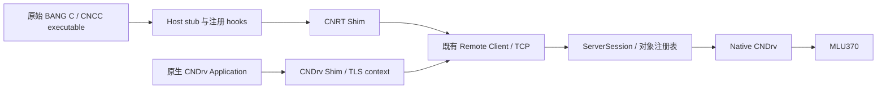

# 透明远程执行总体设计

日期：2026-11-02。设计依据当前安装 SDK、CNCC 产物和真机探针；其他 Neuware/架构需要独立适配和验收。

## 拦截层选择

第一层使用原生 CNRT ABI 和 CNCC 私有注册 hooks，服务端复用现有 CNDrv backend。第二层现已提供部分原生 CNDrv client ABI，普通 Driver 应用经独立 libcndrv.so Shim 接入相同 core/session/backend。两层分别验收；不把服务端使用 CNDrv 当作客户端 API 兼容。

选择理由：当前 CNCC executable 动态依赖 `libcnrt.so`，host stub 直接调用 `__bangRegisterFatBinary/Function` 和 `cnrtInvokeKernel`。在此边界可以获取原始 image、host function identity、完整参数列表和 queue。直接用 CNDrv Shim 承接未改造的 vendor CNRT，需要覆盖其初始化、context、attributes、module、memory 等内部调用；当前 180 个 Driver 公共入口只有 34 个提供导出，不能据此承诺任意 vendor CNRT 可经 Driver Shim 透明执行。

Driver context/module/NULL queue 的独立模型、HELLO16 / MODULE_LOAD_BINARY / CONTEXT_SYNC / SESSION_CLOSE、native 对照及未完成边界见 [DRIVER_SHIM](../docs/DRIVER_SHIM.md)。CNRT 的延迟注册上传和 Driver 的立即 module load 使用不同客户端适配，在服务端汇合到同一个 native module/KernelID/AllocationID 体系。

## 客户端

- `shim/cnrt_shim.c` 导出目前支持的 CNRT 和 6 个私有 hooks，SONAME 为 `libcnrt.so`。构造期只保存注册信息，不要求连接服务器。
- 注册 wrapper 和 image 必须位于可读 ELF PT_LOAD 文件区间。复制并持有原始 image，注销时卸载对应远程模块。
- 参数数量、sizes、offsets 来自内层 device ELF；参数类别通过完整 Itanium demangle 签名判定，仅接受 primitive scalar 和 primitive/void 的单层指针。不能通过“标量看起来像地址”判断指针。
- fake device VA 是 PROT_NONE 映射。复制/launch 仅把已登记 VA 转为 AllocationID+offset。free/reset 使 VA 失效，但到进程退出才解除映射，避免旧指针别名到新分配。
- Queue/Notifier 为单调 token；只比较注册表，不解引用用户句柄。当前各 256 个 live slots。
- CNRT 路径一个进程一个 session、一把 mutex 保护状态和完整 RPC；同线程 launch configuration 和 last-error 使用 TLS。CNDrv 路径每个 context 独立 session、另有设备查询 control session，以 TLS current token 绑定调用线程，进程 mutex 串行保护对象与 RPC。尚未优化多线程吞吐或实现 multiplex。
- 纯传输库构建不需要 SDK。Shim builder 需要 SDK 头文件，运行时无 vendor 动态库调用；`libstdc++` 和 `liblz4` 是系统解析依赖。

## Wire 与服务端

保留 24-byte MLUR v1 frame、network byte order、单调 request sequence、common error prefix。新增 MODULE_LOAD_IMAGE(26)、KERNEL_LAUNCH_GENERIC(27)、TRANSFER_RELEASE(28)，其余 opcode 不改号。HELLO 新 cap bits 为 0x100/0x200/0x400；最后一个 word 为 kernel ABI 0x08010001。客户端上传/launch 前检查 capability 和 ABI。

Driver 增量继续新增 MODULE_LOAD_BINARY(30)、SESSION_CLOSE(31)、CONTEXT_SYNC(32)，HELLO16 在原有 device ordinal 后附加 context flags，返回 `MLU_CAP_DRIVER_CONTEXT=0x1000`。新 Driver Client 对缺少该能力的 peer 明确拒绝；旧 8/12-byte HELLO 与 CNRT/preset 路径保留。Driver module 在 load 时立即加载，close 先完成 native cleanup 再回复 ACK 并关闭 socket，context sync 调用真实 `cnCtxSync`。

通用参数的 descriptor 是 kind/u32、size/u32、AllocationID/u64、offset/u64、reserved/u64，随后 size 个字节。pointer kind 的尾部为占位，不携带真实指针；scalar 为本地 LP64 little-endian ABI bytes。framing 为 network order **不代表 scalar 已实现异构 CPU ABI 转换**。当前只验收 AArch64→AArch64，本实现编译时限制 LP64 LE。

每个成功 HELLO 的 socket 保留独立 CNcontext、owner token 和 Allocation/Queue/Notifier/Module/Kernel/Transfer 注册表；每类最多 1024 个 live slots，另受总注册表限制。对象 ID 由全进程不复用 sequence XOR 内核随机启动 nonce 得到，保持 owner/type/live 检查；跨 session、reset、unload 失效，跨重启抗碰撞依赖 64-bit 随机空间。非法首包及等待 HELLO 的 socket 不创建设备 context。

上传路径先验证大小、ELF section 范围、CNFB v2 压缩 span、LZ4 输出、device parameter metadata，再复制 image 调 `cnModuleLoadFatBinary`，按完整符号 `cnModuleGetKernel`。server 逐项核对 arg count/size、class、非零 xyz、module-kernel-queue 归属、allocation offset，再构造 native `void **params` 调 `cnInvokeKernel`。scalar storage 按 16 bytes 对齐。

当前每次 FatBinary registration 只 lazy 上传并加载一个远程 module，首个 Kernel 由 opcode 26 返回，后续符号使用 `MODULE_GET_KERNEL=29` 查询。同一 module 中每个符号取得稳定的独立 KernelID，服务端逐次检查 parent ModuleID；unload 先同步队列，再使全部子 KernelID 失效。独立加载的相同 image 不合并，保留各自设备状态。旧六 preset 的协议与执行路径继续保留。

原生探针确认普通未初始化 `__mlu_device__ int[4]` 的 RegisterVar 参数 ext/constant/global 均为 0，host size=16，但 device ELF 的 OBJECT size=64，section 为 `.data.gdram_uninit.<name>`。Shim 校验该类 metadata，设备存储和 relocation 由同一个原生 CNDrv module 持有，已验证两个 Kernel 共享状态。初始化/constant/external 变量及 Host symbol address/copy API 不在这一支持范围。动态 loader 保持 DSO 引用计数；20 次重复 dlopen/dlclose、保留一个 loader 引用、pending-work unload、reset 后重载均有原生/远程对照。并发卸载压力、跨 DSO image 引用与 multi-arch 仍待验收。

HELLO 新增 `MLU_CAP_MODULE_KERNELS=0x800`；旧 peer 未声明能力时 lookup 明确返回 Unsupported，不另加载第二份 module 伪装共享状态。客户端严格校验新回复恰好为 8 字节。详见 [共享模块证据](../evidence/shared-module-20261102/README.md)。

旧六算子仍走 preset registry/manifests 和原 operator RPC。原生 Shim 不做名称到 preset 的替换；测试中同名 `vector_add` 执行减法加 17，以结果证明执行的是用户 image。

## 异步和生命周期

H2D 在 server snapshot 主机数据后 enqueue，持有 staging 到队列完成。新 H2D 前 query 该 queue，成功才回收其 staging；queue sync/free/destroy/unload/cleanup 也在完成后回收。D2D 原生 enqueue。D2H 目前在回复前同步 queue 并发送数据，因此 `cnrtMemcpyAsync(D2H)` 为 PARTIAL，不能承诺真正异步主机写回。

每次 queued 操作后放 native notifier 得到 TransferID。Shim 提交后调用非阻塞 release：只标记可回收，query 完成才销毁 notifier。旧显式 TransferID API 的调用者可自行 query/sync/release。连续 1200 launch/copy 通过，没有因保留全部完成事件而在 1024 次耗尽。

free、queue destroy、module unload 和 reset 使用保守同步，优先正确性。EOF cleanup 顺序：同步队列→释放 staging/transfer notifier→卸载模块→销毁用户 notifier/queue→释放设备内存→清注册表→销毁 context。Client 在完整回复结构验证通过后才返回成功或输出句柄/数据。断线、截断、序号错误、无效成功结果均关闭 socket，使 context 失效；后续调用不再发送请求。原生 API 的正常错误不使连接失效。未完成操作状态不可恢复；不存在安全的自动重放。

Client TCP connect 与 RPC、Server 首包和 frame 收发均使用绝对 monotonic deadline，超时也使 session 失效。默认 RPC/Server I/O 为 120000ms，Server 接收预算含请求间空闲；可配置到 3600000ms。重复 HELLO 拒绝并关闭。DNS、锁排队和 native CNDrv/cleanup 没有执行时限保证；socket timeout 不等于 native 取消。具体配置、错误映射和重启探针见 [连接生命周期](../docs/TRANSPORT_LIFECYCLE.md)。

## 兼容与限制

同一个普通 CNCC binary 已分别原生、replacement、preload 运行。replacement 使用 LD_LIBRARY_PATH；preload 使用 LD_PRELOAD。当前 DT_NEEDED 和 Shim SONAME 都为 `libcnrt.so`。静态 CNRT、其他版本 SONAME、symbol version、绝对 dlopen、RTLD_DEEPBIND、应用自定义 linker namespace 尚未适配；不能承诺任意 executable 只加环境变量即兼容。缺失 API 导出可在 loader 阶段失败，8 个显式拒绝导出不代表全部未实现 API 均有 NotSupport stub。

完整 SDK error names/strings 尚未生成，已知等值 driver errors 显式映射，未知错误映射 CndrvFuncCall。完整错误等价、多设备/TLS device、默认 queue 隐式顺序、pinned memory、IPC、callbacks、graphs、Host symbol API、初始化/constant globals、multi-arch image、并发动态卸载压力均有后续工作。

边界验证是协议健壮性，不是 Kernel 安全沙箱。任意 Kernel 可自行越界访存；server 无法仅凭 pointer 参数推导访问长度。原生 Driver 仍解析受信任的 device binary；当前 socket deadline 和逻辑资源配额不替代尚缺的认证、物理硬隔离、隔离进程、TLS 及审计。

## 资源边界与关闭

服务端现按连接、session/全进程请求设备字节、H2D snapshot、上传 image 和保留 TransferID 限额；容量在 native 提交前检查，并在失败/完成/销毁后释放。SIGINT/SIGTERM 停止 accept，唤醒 socket 并等待所有 worker 的 native cleanup。原生错误逐项报告；context 销毁失败保留不确定资源并停止准入。D2H 显式 queue 先同步再用同步 native copy，避免 wait 失败后回复缓冲被异步写入。精确默认值、独立 cnmon 对照及未覆盖的 native 内部内存/公平性见 [资源生命周期](../docs/RESOURCE_LIFECYCLE.md)。
