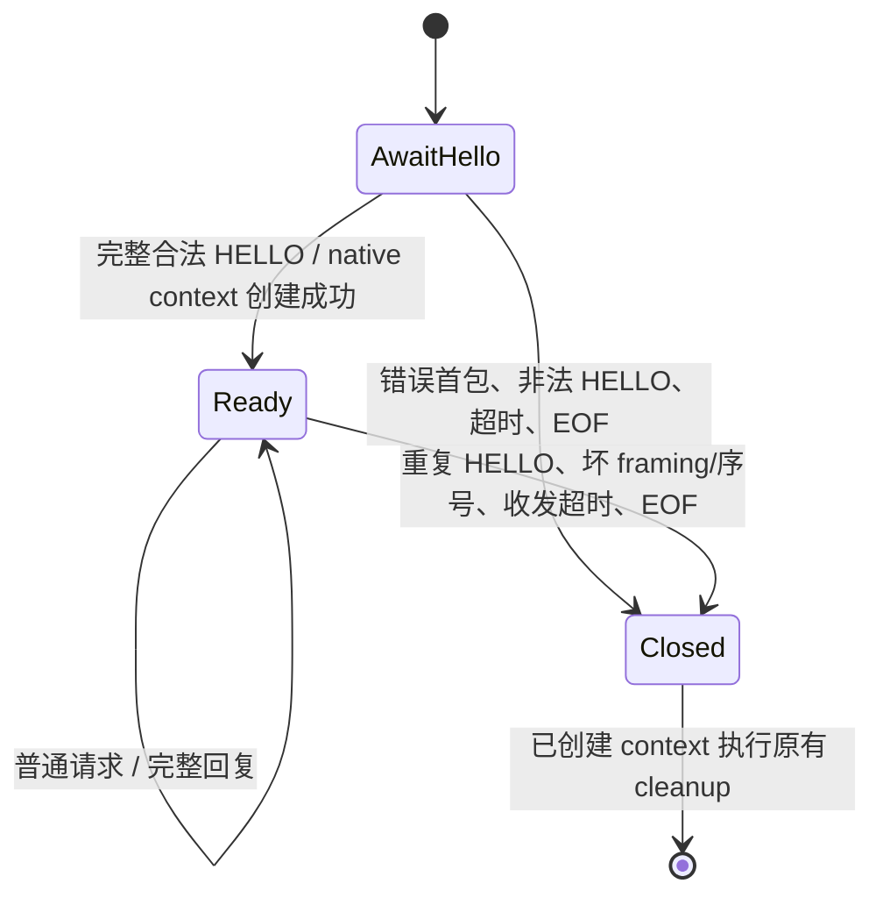

# TCP deadline、首包和失效会话

2026-11-02，M4.1 增量。保留 MLUR v1、现有 RPC 和原生执行路径；不增加业务源码调用要求。

## 时间预算

启动进程前设置，单位为毫秒；只接受十进制整数 `1..3600000`。未设置使用下表默认值，空值、零、负数、溢出和非法字符直接拒绝。Client 在 connect 时固定配置，Server 在启动时固定配置。

| 环境变量 | 默认 | 范围 |
|---|---:|---|
| MLU_REMOTE_CONNECT_TIMEOUT_MS | 5000 | `getaddrinfo` 完成后，全部候选地址共用的 TCP connect 总预算 |
| MLU_REMOTE_RPC_TIMEOUT_MS | 120000 | 每次 RPC 的 request header/body 发送及 response header/body 接收共用预算，HELLO 同样适用 |
| MLU_REMOTE_SERVER_HANDSHAKE_TIMEOUT_MS | 5000 | accept 后接收首个 HELLO frame 的总预算 |
| MLU_REMOTE_SERVER_IO_TIMEOUT_MS | 120000 | 已握手连接每个 incoming frame 的总接收预算，**包括两次请求之间的空闲**；每个 outgoing response 另有同长度总发送预算 |

`include/remote_io.h` 使用 CLOCK_MONOTONIC 的绝对 deadline、poll、MSG_DONTWAIT；短读/短写、EINTR 和 EAGAIN 不刷新预算。Client connect 使用 nonblocking socket 和 SO_ERROR 判断连接结果；Client/Server 都不会在 ready fd 上退回无限期 blocking send/recv。

DNS 解析没有 deadline；mutex 排队、RPC 前参数打包/内存分配也不在这个 socket 时间保证内。Server 的 native CNDrv 调用和 cleanup 没有可取消的执行时间保证。Client 等回复的 deadline 可以先到期，但这不能证明服务器没有执行该操作，或 kernel 已经取消。

长时间计算、同步或主机空闲需要按应用配置上述有限预算。两端配置独立，不进行 deadline 协商，不能只调整 Client 而忽略 Server 的空闲/收发限制。默认值是工程配置，不是 CNRT 原生时限语义。

## HELLO 状态机

首包只能是 HELLO；8-byte legacy request 与 12-byte 带 device request 都保留。version 必须匹配，request flags 必须为零；未知 flags 返回 Unsupported。非法长度/版本/flags/设备、重复 HELLO 会回复错误后断开。服务端只在完整合法 HELLO 后创建 session 的 native context；之前的等待/错误连接不创建 CNcontext。MLU backend 的进程级初始化和设备查询仍发生在服务启动时。

header/body 共用接收 deadline；首包非 HELLO、HELLO 非法长度或重复 HELLO 可以仅看 header 就拒绝，不必等待其 body。Session ready 后 native API 的正常错误仍允许后续请求。

## 超时、重启和显式恢复

Client socket deadline 返回 transport status `MLU_REMOTE_TIMEOUT=0x80000006`、错误名 `REMOTE_TIMEOUT`，并关闭 fd。CNRT Shim 把该状态映射到 `cnrtErrorSys`；初始 connect/HELLO 失败仍返回 `cnrtErrorInit`。Core 调用者可用 `mlu_remote_last_error(ctx)` 查看 RPC 诊断；connect 返回 NULL 时用线程局部的 `mlu_remote_last_connect_error()` 和 errno 查看 `REMOTE_CONNECT_TIMEOUT`、解析错误、配置错误或 HELLO 错误。

超时、断线、坏回复后的 context 永久失效，下一次请求返回 `REMOTE_CONTEXT_POISONED`，不会重新连接或重放，旧 queue/allocation/module 不迁移到新会话。Core 使用者显式 disconnect/connect 并重新建立资源；当前原生 Shim 没有透明恢复入口，应用进程重新启动才能建立新 session。对超时的在途写入/launch，调用者不能据此盲目重试。

真实 restart 探针发现旧实现的第一个 AllocationID 在每次 server 重启后都会重复为 `4294968297`。已把对象身份改为**全进程不复用的 64-bit sequence XOR 内核随机启动 nonce**，每个 session 的 owner/type/live 检查继续保留；零 ID 跳过，sequence/generation 耗尽拒绝注册。熵获取失败拒绝创建 session。进程内 ID 不重复；跨重启抗碰撞依赖 64-bit 随机空间，不能当作持久化唯一标识或认证机制。

证据见 [连接及重启验证批次](../evidence/transport-20261102/README.md)。其中 SIGSTOP/SIGKILL 只作用于测试自己启动的、没有在执行 kernel 的 server；不代表强制取消在运行的 native kernel 已验收。`SESSION_CLEANUP_EMPTY` 和 `SESSION_NO_NATIVE_CONTEXT` 是代码路径证据，不是 native 资源计量。

## 保留的 M4 工作

总连接/字节配额及 SIGINT/SIGTERM worker drain 已新增，见 [资源配额与关闭](RESOURCE_LIFECYCLE.md)。DNS deadline、native 执行取消、显式应用恢复、认证/TLS、长期资源计量和物理跨主机网络故障仍待实现/验收。M4.1 只完成当前文档列明的 socket 和 session 边界。
